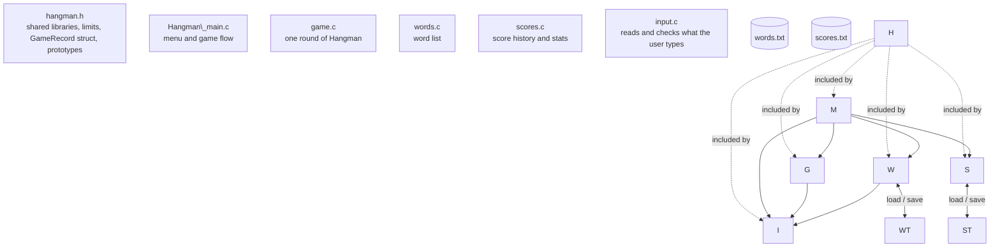

# Hangman in C

A menu-driven Hangman game for the terminal, written in C for ECE 131L (Section 012) by Team 5.

## Team

|Name|Role|File(s)|
|-|-|-|
|Cesar Marquez-Garcia|Team Lead|hangman.h, scores.c, slides|
|Manuel Barnett|Implementation Lead|main.c, readme|
|Christopher Rodriguez|QA / Tester|input.c, test plan|
|Jesse Garcia|Documentation Lead|words.c, function diagram|
|Ean Chino|Presenter / Demo Lead|game.c, report|

## Files in this repository

|File|What it is|
|-|-|
|hangman.h|Shared libraries, limits, the GameRecord struct, and every prototype|
|Hangman\_main.c|The menu, the program's data, and the game flow|
|input.c|Reads and checks everything the user types|
|words.c|The word list and words.txt|
|game.c|One round of Hangman: the board, guesses, and scoring|
|scores.c|The score history, scores.txt, and statistics|
|words.txt|The starting word list|
|report.txt|Project report|
|N/A|Test plan|
|TEAM\_README.md (link)|Presentation slides|

## Requirements

* gcc, version \_\_\_\_\_\_\_\_\_\_ (run `gcc --version` to check)
* We built and tested it in \_\_\_\_\_\_\_\_\_\_\_\_\_\_\_\_\_\_\_\_\_\_\_\_.

## How to build

From the repository folder, compile all five files together:

```
gcc -std=c11 -Wall -Wextra Hangman\\\_main.c input.c words.c game.c scores.c -o hangman
```

A clean build prints nothing. To check one file by itself without building the program, add `-c`:

```
gcc -std=c11 -Wall -Wextra -c scores.c
```

## How to run

```
./hangman
```

Keep `words.txt` in the same folder as the program. At startup, the program loads the word list and the score history and says how many of each it loaded. If `scores.txt` doesn't exist yet, it starts a new history. \_\_\_\_\_\_\_\_\_\_\_\_\_\_\_\_\_\_\_\_

## How to play

|Option|What it does|
|-|-|
|1. Play Hangman|Enter your name, then guess the word one letter at a time|
|2. Add a word|Adds a new word of 3 to 24 letters to the list|
|3. Show word list|Prints every word in the list|
|4. Score History|Shows every game played, as a table|
|5. Show stats|Games, wins, losses, win rate, averages, and the best game|
|6. Save words and scores|Writes `words.txt` and `scores.txt`|
|0. Quit|Asks whether to save first, then exits|

* Type one letter per guess. Uppercase letters count as lowercase.
* Guessing a letter you already tried costs nothing.
* Six wrong guesses lose the round.

**Scoring:** a win earns 10 points per letter plus 20 points per life left. A loss earns 0. For example, solving "diode" with 2 wrong guesses scores 10 × 5 + 20 × 4 = 130.

## Example run

```
$ ./hangman
Welcome to Hangman
Words loaded from words.txt: 12
No score history yet, starting new score history.

WELCOME TO HANGMAN
 1. Play Hangman
 2. Add a word
 3. Show word list
 4. Score History
 5. Show stats
 6. Save words and scores
 0. Quit hanging that poor man
Choose an option: 1
Player name: Manny

Manny started a new game, the chosen word has 10 letters
  \_\_\_\_\_
  |   |
      |
      |
      |
      |
=========
Word:  \_ \_ \_ \_ \_ \_ \_ \_ \_ \_
Guessed: 
Lives: 6
Guess a letter: A
 Good Job! 'a' is in the word.

  \_\_\_\_\_
  |   |
      |
      |
      |
      |
=========
Word:  \_ \_ a \_ \_ \_ \_ \_ \_ \_
Guessed: a
Lives: 6
Guess a letter: e
 Sorry, 'e' is not in the word.

  \_\_\_\_\_
  |   |
  O   |
      |
      |
      |
=========
Word:  \_ \_ a \_ \_ \_ \_ \_ \_ \_
Guessed: ae
Lives: 5
Guess a letter: i
 Good Job! 'i' is in the word.

  \_\_\_\_\_
  |   |
  O   |
      |
      |
      |
=========
Word:  \_ \_ a \_ \_ i \_ \_ \_ \_
Guessed: aei
Lives: 5
Guess a letter: o
 Good Job! 'o' is in the word.

  \_\_\_\_\_
  |   |
  O   |
      |
      |
      |
=========
Word:  \_ \_ a \_ \_ i \_ \_ o \_
Guessed: aeio
Lives: 5
Guess a letter: u
 Sorry, 'u' is not in the word.

  \_\_\_\_\_
  |   |
  O   |
  |   |
      |
      |
=========
Word:  \_ \_ a \_ \_ i \_ \_ o \_
Guessed: aeiou
Lives: 4
Guess a letter: t
 Good Job! 't' is in the word.

  \_\_\_\_\_
  |   |
  O   |
  |   |
      |
      |
=========
Word:  t \_ a \_ \_ i \_ t o \_
Guessed: aeiout
Lives: 4
Guess a letter: r
 Good Job! 'r' is in the word.

  \_\_\_\_\_
  |   |
  O   |
  |   |
      |
      |
=========
Word:  t r a \_ \_ i \_ t o r
Guessed: aeioutr
Lives: 4
Guess a letter: n
 Good Job! 'n' is in the word.

  \_\_\_\_\_
  |   |
  O   |
  |   |
      |
      |
=========
Word:  t r a n \_ i \_ t o r
Guessed: aeioutrn
Lives: 4
Guess a letter: s
 Good Job! 's' is in the word.

  \_\_\_\_\_
  |   |
  O   |
  |   |
      |
      |
=========
Word:  t r a n s i s t o r
Guessed: aeioutrns
Lives: 4
You saved the man to be hung! The word was transistor!
Score this game 180
Play Again (y/n)?:
```

## File formats

|File|One line holds|Example|
|-|-|-|
|words.txt|One word, 3 to 24 letters only|`resistor`|
|scores.txt|One game: player, word, won (1 or 0), wrong guesses, score, separated by spaces|`Cesar diode 1 2 130`|

Words that are too short, too long, or not all letters are skipped when `words.txt` loads. A line in `scores.txt` that is cut off stops the loading, and the broken game isn't counted.

## How the files connect



`hangman.h` is included by every `.c` file. `Hangman\_main.c` runs the menu and calls into `game.c`, `words.c`, `scores.c`, and `input.c`. `game.c` and `words.c` also use `input.c` for reading and checking what the user types. `words.c` loads and saves `words.txt`, and `scores.c` loads and saves `scores.txt`.

## Assumptions and limits

* Player names are one word of up to 24 letters, with no spaces.
* The score history holds up to 100 games.
* Each round allows 6 wrong guesses.
* `words.txt` and `scores.txt` are read from the folder the program runs in.

## Known issues

None known.

